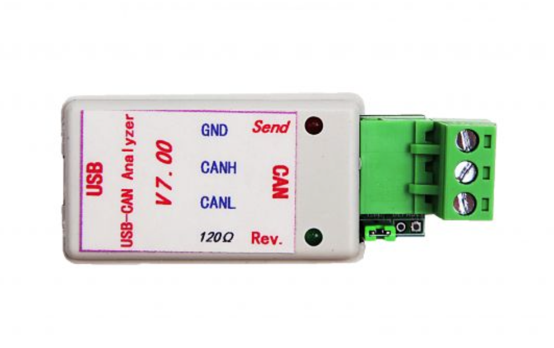

# CAN GNSS receiver firmware

Firmware for Etherform's GNSS receiver board. An STM32G0B1KB reads a u-blox MAX-M10M over I²C and
publishes the position on a DroneCAN bus, in the messages that PX4 and ArduPilot expect from a
GNSS node.

## Hardware

From the board's schematic and PCB:

- **Power:** 5 V on J3 pin 2 (pins 3 and 4 are ground). A linear regulator (LD1117-3.3) makes the
  3.3 V rail for the MCU and the receiver, so the 5 V input carries the 3.3 V rail's current plus
  the regulator's own quiescent current.
- **CAN:** J3 pin 5 is CAN_P and pin 6 is CAN_N, through an MCP2562FD transceiver. Fitting jumper
  JP1 connects a 120 Ω termination resistor (R7) across the bus.
- **Programming:** J5 is the SWD header (pin 3 is 3.3 V, 4 is SWDIO, 6 is SWCLK, 12 is NRST, and 5, 7
  and 11 are ground).
- **Node ID jumpers:** J1, see below.
- **GNSS receiver:** a u-blox MAX-M10M on I²C. It has no backup battery (V_BCKP is not connected), so
  it starts cold after every power-up and needs time to find the time and a position again.

## What the board does

- Runs as a DroneCAN node: classic CAN, 29-bit IDs, **1 Mbit/s**, static node ID.
- Publishes

  | Message | Data type ID | Rate |
  |---|---|---|
  | `uavcan.equipment.gnss.Fix2` | 1063 | once per receiver solution, 10 Hz by default |
  | `uavcan.equipment.gnss.Auxiliary` | 1061 | 1 Hz, sent about 30 ms after a `Fix2` |
  | `uavcan.protocol.NodeStatus` | 341 | 1 Hz |

- Answers `uavcan.protocol.GetNodeInfo` (name `CAN to GPS`, version 0.1, the chip's 96-bit unique ID).
- Lets the node ID be set over CAN with the standard parameter services (`uavcan.protocol.param.GetSet`
  and `ExecuteOpcode`) and applied with `uavcan.protocol.RestartNode`; see Node ID below.
- Configures the receiver for 10 Hz output and the **airborne <4g** dynamic platform model over I²C
  (the receiver's default model limits speed, altitude and acceleration far below what a UAV reaches),
  and reads its NMEA stream (GGA, GSA, GSV, RMC).
- Reports its health in `NodeStatus`. Having no fix is not a fault; a missing or silent receiver is:

  | Health | Vendor status | Meaning |
  |---|---|---|
  | OK | 0 | The receiver is producing solutions. |
  | WARNING | 2 | The receiver answered once but has sent no solution for 3 s. |
  | ERROR | 1 | The receiver has never answered on I²C. |

  The node starts on CAN whether or not the receiver is present, and keeps trying to reach it every
  500 ms. If solutions arrive more slowly than configured (for example the receiver restarted and
  is back at its default 1 Hz), the 10 Hz setting is sent to it again.
- Recovers by itself from CAN bus-off: it restarts the controller 100 ms after going bus-off and
  discards frames queued in the meantime.

### Message contents

- `Fix2`: latitude/longitude in 1e-8 degrees, height above the MSL and above the ellipsoid
  (MSL height plus the geoid separation), horizontal velocity from ground speed and course
  (vertical velocity is reported as 0, NMEA doesn't have it), satellites used, fix status
  (none / 2D / 3D), mode and PDOP.
- `gnss_timestamp` is UTC built from the RMC date and time (`gnss_time_standard` UTC). It is 0 until
  the receiver knows the time. The network `timestamp` field is always 0.
- The covariance is left empty. PX4 then derives accuracy from the HDOP/VDOP in `Auxiliary`.
- Without a fix, position and height are 0 with status "no fix".
- `Auxiliary`: PDOP, HDOP, VDOP (the others are NaN), satellites in view and used.

## Node ID and settings

The node ID is **16 plus the number set on the four ID pins** on J1, GPIO1 to GPIO4 (J1 pins 1, 3,
5 and 7, with ground on the even pins). The pins have pull-ups, so **fitting a jumper from a pin to
ground sets its bit to 1** and an open pin reads 0. GPIO1 is the least significant bit, so the
jumpers select IDs 16 to 31, and with no jumpers fitted the ID is 16.
The pins are read **only at startup**: after changing a jumper, reset or power-cycle the board.
Each fitted jumper draws about 0.33 mA, through the 10 kΩ pull-up (3.3 V / 10 kΩ), which is
about 1.7 mW at the 5 V input.

| Jumpers fitted (rows) | Node ID |
|---|---|
| none | 16 |
| row 1 (pins 1 and 2) | 17 |
| row 2 (pins 3 and 4) | 18 |
| row 3 (pins 5 and 6) | 20 |
| row 4 (pins 7 and 8) | 24 |
| all four | 31 |

- A node ID stored in flash page 62 (byte at `0x0801F000`) overrides the jumpers and is used as is,
  without the offset of 16. It must be 1 to 127 (DroneCAN doesn't allow 0); an erased page or any other
  value is ignored and the jumpers are used.
- Flash page 63 (byte at `0x0801F800`) holds the receiver's measurement period in milliseconds
  (minimum and default 100, which is 10 Hz).
- Flash page 61 (`0x0801E800`) is reserved. The linker script limits the application to the space
  below `0x0801E800`, so a build that grows into these pages fails to link. The image is about
  113 KB, which leaves roughly 11 KB of headroom.

Erased flash (all `0xFF`) means "not set".

### Setting the node ID over CAN

The node has one parameter, **`NODE_ID`** (0 to 127), which is stored in the flash page above. It can be
changed with any DroneCAN tool that speaks the parameter services, or with `tools/can_param.py`:

```bash
pip install dronecan pyserial
python3 tools/can_param.py <node id> get          # show the stored value (0 = not set)
python3 tools/can_param.py <node id> set 42       # store 42
python3 tools/can_param.py <node id> restart      # use it
python3 tools/can_param.py <node id> set 0        # remove it, so the jumpers decide again
```

- The new ID is **used after the node restarts** (`RestartNode`, or a power cycle). A running node keeps
  its ID, so it is still reachable on the old one until then.
- Values outside 0 to 127 are ignored and the reply shows the value that is actually stored.
- Writing erases a flash page, which stops the processor for a few tens of milliseconds, so don't do it
  while the aircraft depends on the GNSS data.
- `ExecuteOpcode` save is accepted (values are stored immediately) and erase clears the stored ID.

## Building

You need CMake 3.15 or newer, `arm-none-eabi-gcc` (tested with the 12.3.rel1 toolchain that ships
with STM32CubeIDE 1.16), Python 3 with `venv`, git and network access to GitHub.

```bash
export PATH=/path/to/arm-none-eabi/bin:$PATH
mkdir build_stm && cd build_stm
cmake .. -DARCH=STM
make
```

The configure step fetches [libcanard](https://github.com/dronecan/libcanard), the DroneCAN DSDL
definitions and the `dronecan_dsdlc` generator, all pinned to specific commits
(`cmake/dronecan_c.cmake`), and generates the C message code in a Python virtualenv inside the
build directory. The firmware is `build_stm/stm_generated/can_gps_firmware.elf`.

## Flashing

With an ST-LINK, OpenOCD (the copy that ships with STM32CubeIDE is ST's fork):

```bash
openocd -s <openocd scripts> -f interface/stlink-dap.cfg -c "transport select dapdirect_swd" \
        -f target/stm32g0x.cfg -c "program can_gps_firmware.elf verify reset exit"
```

With a stock OpenOCD use `-f interface/stlink.cfg -f target/stm32g0x.cfg`. Programming the code
pages does not touch the settings pages. In testing, STM32CubeProgrammer repeatedly crashed an
ST-LINK V3 while an application was running, and OpenOCD was reliable.

### Programming and checking boards with `tools/flash_and_check.py`

For one board at a time, this script programs the firmware over SWD with OpenOCD, resets the board and
checks that it works. It needs Python 3 and OpenOCD (set `OPENOCD` and `OPENOCD_SCRIPTS` if they are not
on the PATH). The CAN check also needs `pyserial` and a USB-CAN adapter, as in the next section.

```bash
tools/flash_and_check.py                       # program the newest build, then check it over CAN
tools/flash_and_check.py --elf path/to/can_gps_firmware.elf
tools/flash_and_check.py --check-only          # do not program: just read and check the board
tools/flash_and_check.py --can-device none     # program only, no CAN check
tools/flash_and_check.py --set-node-id 42      # also store node ID 42 (1 to 127)
tools/flash_and_check.py --clear-node-id       # also remove a stored ID, so the jumpers decide again
```

What it does, in order:

1. Reads the board's stored node ID, stored update rate and the chip's unique ID.
2. Programs and verifies the firmware. The settings pages are not touched, so a stored node ID survives a
   firmware update. Use `--set-node-id` or `--clear-node-id` to change it.
3. Resets the board and works out which node ID it should be using: the stored ID if there is one,
   otherwise 16 plus the jumpers.
4. Asks that node for `GetNodeInfo` over CAN and checks that the reply is valid and the health is OK.
5. Prints **PASS** or **FAIL** and exits with 0 only for PASS.

Notes:

- Other options are `--probe-serial` to choose one of several ST-LINKs, `--interface` and `--stock` for a
  stock OpenOCD (the copy that ships with STM32CubeIDE needs the defaults), and `--boot-wait` to allow a slow
  start.
- A board that is not connected to the CAN bus fails the check even though it was programmed correctly:
  nothing acknowledges its frames, so it cannot answer. Check the CAN wiring (J3 pins 5 and 6 and ground) and
  the termination. Use `--can-device none` to skip the check when the board is not on a bus yet.
- A new board has no stored node ID and starts as node 16 with no jumpers fitted. Two boards on one bus
  need different IDs, so set the ID with `--set-node-id`, the jumpers or `tools/can_param.py`.

## Watching the CAN traffic

`tools/can_monitor.py` decodes `Fix2` and `Auxiliary` from a serial USB-CAN adapter (the 2 Mbaud
"USB-CAN analyzer" type), checks the multi-frame CRCs, reports the rates and shows the node's
`NodeStatus` (uptime, health and vendor status). `tools/can_getnodeinfo.py` sends a `GetNodeInfo`
request and decodes the reply:

```bash
pip install pyserial
python3 tools/can_monitor.py /dev/ttyUSB0 <node id> 30
python3 tools/can_getnodeinfo.py /dev/ttyUSB0 <node id>
```

The monitor decodes the position fields with a simple decoder that has only been checked on empty
messages. To check real position data, decode the payload with the reference
[DroneCAN Python library](https://github.com/dronecan/pydronecan) instead.



Notes from bring-up:

- Plug the adapter straight into the computer. Behind a USB hub it stopped streaming after a
  second or two.
- The adapter only streams while DTR and RTS are asserted. The scripts do that.
- Reconfiguring the adapter briefly stops it acknowledging frames, which can push the board
  bus-off. The firmware recovers within about 100 ms.
- The adapter loses frames in long back-to-back bursts, which is why `Auxiliary` is sent a few
  milliseconds after `Fix2` and not in the same burst.

## Tests

The NMEA parser and the message builders have unit tests that run on the PC. They need only CMake,
a C/C++ compiler, Python 3 and network access to GitHub (the same pinned dependencies as the firmware
build, plus GoogleTest).

```bash
mkdir build_host && cd build_host
cmake .. -DARCH=HOST
make
./tests/parser_tests
```

They cover a full fix, the southern and western hemispheres, the empty fields of a no-fix sentence
(captured from the receivers), checksum rejection, data split across reads, date and time
conversion, and the contents of the `Fix2` and `Auxiliary` messages.

## Status

Verified on hardware:

- The `Fix2`, `Auxiliary`, `NodeStatus` and `GetNodeInfo` traffic, including CRCs against the DroneCAN
  definitions used by PX4, at the full 10 Hz rate.
- Node ID selection: with no jumpers the ID is 16, and the flash override (used as is when 1 to 127,
  ignored otherwise) behaves as described above. Each jumper row and one combination were checked
  before the offset of 16 was added; **jumpers with the offset have not been re-checked on the board.**
- Health reporting and recovery when the receiver is powered off and back on, and with no receiver
  present.
- Setting the node ID over CAN with the reference DroneCAN library: set, store, restart and use the new
  ID, reject out-of-range values, and clear it. The receiver acknowledged the dynamic model and rate
  configuration.
- Bus-off recovery: after the bus stopped acknowledging the board, `Fix2` resumed without a reset.

A populated `Fix2` and `Auxiliary` produced by the firmware's encoder were decoded with the reference
DroneCAN Python library and gave the expected position, height, velocity, time and satellite count.

Not yet verified: reporting of a real position (no outdoor test yet; the parser is covered by unit
tests using sentences captured from the receivers) and operation with a PX4 or ArduPilot flight
controller. On the PX4 side, enable UAVCAN, set `UAVCAN_SUB_GPS`, and use a node ID that doesn't
clash with the flight controller's own.

## Layout

- `board/` firmware sources: the CAN node (`Canard_gnss_node.h`), the FDCAN and I²C drivers, the
  NMEA parser (`Nmea_parser.h`) and message builders.
- `stm_generated/` CubeMX project: startup code, clock and pin setup, `main.cpp`.
- `cmake/` dependency fetching and message code generation.
- `tools/` host-side tools: flashing and checking a board, and CAN monitoring and configuration.
- `tests/` unit tests that run on the PC.
- `LICENSE`, `THIRD_PARTY_LICENSES.md` the project licence and the third-party notices.

## Licence

The firmware in this repository is licensed under the **MIT licence**; see `LICENSE`. Copyright (c) 2026
Ether Form Inc. Each source file carries an `SPDX-License-Identifier: MIT` line.

It includes and is built with third-party code under its own licences, listed with their notices in
[`THIRD_PARTY_LICENSES.md`](THIRD_PARTY_LICENSES.md):

- the ST HAL driver (BSD-3-Clause) and the CMSIS headers (Apache 2.0), included under `stm_generated/Drivers`,
  and the files generated by STM32CubeMX under `stm_generated/Core`, which keep ST's own headers;
- libcanard and the DroneCAN DSDL definitions (MIT), fetched at build time;
- the C message code generated by `dronecan_dsdlc`. The generator is LGPL/GPL, but its licence lets you
  distribute a product that embeds the generated code under the MIT licence, which the firmware binary does.
  Include the notice in `THIRD_PARTY_LICENSES.md` when you distribute the firmware.
